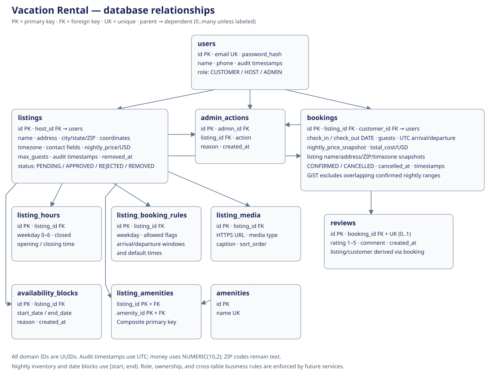

# Database schema

The implemented schema is defined in `backend/app/models/` and frozen in the initial Alembic migration. This document and the API contract resolve older draft field/state wording in the V2 design.

- [ERD source](diagrams/erd.mmd)
- [Readable ERD export](diagrams/erd.svg)

## Conventions and fields

UUIDs identify domain rows. `listing_amenities` uses a composite primary key. Foreign keys use `RESTRICT` so historical bookings/reviews cannot disappear through accidental parent deletion. Services will implement soft removal and enforce roles/ownership in their scheduled phases; ordinary user FKs alone do not prove a Host/Customer/Admin role.

Audit and booking snapshot timestamps use PostgreSQL `TIMESTAMP WITH TIME ZONE`; application connections use UTC. Local stay dates use `DATE`, weekly windows use `TIME`, Monday is weekday 0 and Sunday is 6, and timezone fields contain IANA names. IANA existence and DST ambiguity checks belong to service validation. Contact hours and arrival/departure rules are separate tables.

Money uses `NUMERIC(10,2)` and Python `Decimal`, with USD currency checks. The listing price field is `nightly_price`. Bookings retain `nightly_price_snapshot`, `total_cost`, `currency`, `listing_name_snapshot`, `listing_address_snapshot`, `listing_zip_snapshot`, `listing_timezone_snapshot`, `arrival_at`, and `departure_at`. ZIPs are text, preserving `02108`.

Persisted reservation states are only `CONFIRMED` and `CANCELLED`; completion is derived after checkout by the future API. Nightly inventory uses `[check_in, check_out)`, constrained to 1–14 nights. `availability_blocks` uses the same half-open date convention with no AVAILABLE override. Customer and listing IDs for a review are obtained through its unique booking FK.

## Integrity and indexes

Checks enforce normalized email, known enum values, coordinate bounds, positive prices/capacity/guests, ordered dates/UTC times, calculated totals, cancellation/removal timestamp consistency, rating 1–5, valid weekly windows, HTTPS media URLs, and nonempty rejection/removal reasons.

`btree_gist` supports a partial GiST exclusion constraint combining listing UUID equality and overlapping date ranges for `CONFIRMED` bookings. Cancelled bookings do not consume inventory, and adjacent date ranges are allowed. This is database defense in depth: Phase 6 must still lock the listing row and test service races involving bookings, blocks, and moderation across independent transactions.

Indexes cover approved location/ZIP search, Host status scope, listing-date overlap, Customer booking history, listing/booking creation time and ZIP analytics, media ordering, and moderation history. Review booking uniqueness supplies its lookup index.

## Development and tests

Run `make db-up`, `make migrate`, and `make seed`. Run `make test TEST_PATH=tests/database` for real PostgreSQL migration, constraint, overlap, seed, type, history, and readiness checks. `make schema-check` reports model/migration drift on the development schema.

Each integration test creates a new schema with a generated UUID inside the separate local test database, applies the real migration, and deletes only that schema at teardown. The initial migration installs `btree_gist` into the test database's public schema; it is retained between tests. Tests never reset a database or delete a volume. Downgrade/upgrade roundtrips are exercised only in these temporary schemas.

The seed uses deterministic UUIDs and `ON CONFLICT DO NOTHING` on primary keys, never updates/deletes. A conflict on a different unique field aborts the transaction instead of silently accepting a partial dataset. Demo timelines are anchored to the seeded Admin's initial creation timestamp plus 200 days. Analytics fixtures are relative to that anchor; later analytics tests must freeze `as_of` accordingly.

## Official references

- [Alembic async migrations](https://alembic.sqlalchemy.org/en/latest/cookbook.html#using-asyncio-with-alembic)
- [SQLAlchemy PostgreSQL exclusion constraints](https://docs.sqlalchemy.org/en/20/dialects/postgresql.html#sqlalchemy.dialects.postgresql.ExcludeConstraint)
- [PostgreSQL btree_gist extension](https://www.postgresql.org/docs/16/btree-gist.html)
- [bcrypt package and Python support](https://pypi.org/project/bcrypt/)
