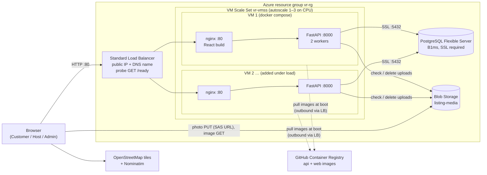

# Deployment (Azure)

Assignment requirement: *deploy APIs and Database to AWS or another cloud provider in an Auto Scaled EC2 Cluster with Load Balancer*, with a UI that calls the deployed APIs. We use Azure for Students.

| Requirement | Azure resource |
|---|---|
| Auto-scaled EC2 cluster | **Virtual Machine Scale Set** `vr-vmss` (Ubuntu 24.04, `Standard_B2ats_v2`), CPU autoscale 1–3 instances |
| Load balancer | **Standard Load Balancer** `vr-lb`: public IP + DNS name, HTTP rule on port 80, health probe `GET /ready` |
| Database | **Azure Database for PostgreSQL Flexible Server** (Burstable B1ms, PostgreSQL 16, 32 GB) |
| UI calling the deployed APIs | React build served by nginx on every VM; nginx proxies `/api/v1` to FastAPI on the same VM |
| Host media uploads | **Azure Blob Storage** container `listing-media` (shared by all VMs; see [media storage](media-storage.md)) |

## Architecture



Design decisions:

- **Stateless API VMs.** JWTs are signed with one shared `JWT_SECRET_KEY`, all data is in PostgreSQL, and uploads go to Blob Storage, so any VM can answer any request and VMs can be added or removed at any time.
- **Same origin for UI and API.** nginx serves the React build and proxies `/api`, so the browser needs no CORS and the build has no hard-coded host (`VITE_API_BASE_URL=/api/v1`).
- **Real client IPs.** The Standard Load Balancer works at layer 4 and keeps the client's IP. nginx overwrites `X-Forwarded-For` with it, and uvicorn trusts that header only from nginx, so the per-IP login limiter works per user. A client-supplied `X-Forwarded-For` is ignored.
- **Readiness probe.** The load balancer probes `GET /ready`, which checks the database and the schema version. A VM that can't reach the database stops receiving traffic.
- **Images, not builds, on the VMs.** GitHub Actions builds the images once (`.github/workflows/images.yml`); each VM only pulls them. A new autoscaled VM is serving in ~3–5 minutes.
- **Outbound through the load balancer.** VMs have no public IPs. An LB outbound rule gives them internet access for apt and image pulls, and PostgreSQL allows only the LB's IP.
- **Cost-first choices.** Free-tier VM, database and load balancer. No NAT Gateway, Application Gateway, Key Vault or Azure Container Registry, each of which would exceed the $10 budget. HTTP only, because the assignment does not require HTTPS.

## Files

| File | Purpose |
|---|---|
| `backend/Dockerfile` | API image. `EXTRAS=azure` adds the Blob Storage SDK |
| `frontend/Dockerfile`, `frontend/nginx.conf` | React build stage + nginx image (static files, `/api` proxy, SPA routing) |
| `deploy/compose.prod.yaml` | What runs on each VM: `web` (port 80) + `api` (internal only) |
| `deploy/compose.build.yaml` | Local override: build the images from source, serve on `localhost:8080` |
| `deploy/cloud-init.yaml` | First-boot script for every VM: install Docker, write config, start containers |
| `deploy/deploy.sh` | All Azure steps as commands (`init`, `check`, `infra`, `db-load`, `vms`, `status`, `update`, `logs`, `pause`, `resume`, `destroy`) |
| `deploy/azure.env.example` | Names and sizes. `init` creates `deploy/azure.env` with secrets (ignored by Git) |
| `.github/workflows/images.yml` | Builds both images on PRs. Publishes to `ghcr.io` on pushes to `main` |

## Step 0: test the production setup locally ($0)

Do this first. If it works here, problems on Azure are network or config problems, not app problems.

```bash
make db-up && make migrate && make seed            # local dev database, as usual
cp deploy/.env.prod.example deploy/.env.prod
python3.12 -c 'import secrets; print(secrets.token_urlsafe(48))'   # paste into JWT_SECRET_KEY
make prod-local-up                                  # builds both images, http://localhost:8080
```

Check `http://localhost:8080`, `/ready` and `/docs`, and log in with a demo account. Stop with `make prod-local-down`. (Uploading photos in this mode is expected to fail. `APP_ENV=production` rejects local-disk media URLs; on Azure, uploads go to Blob Storage.)

## Step 1: publish the images (once, repo owner)

1. Merge this branch to `main`. The **images** workflow publishes `ghcr.io/suprithamallaradhya/vacation-rental-api` and `…-web`.
2. The repository owner opens GitHub → profile → **Packages** → each package → **Package settings** → **Change visibility → Public**. The VMs then pull without credentials. (Alternative: keep them private and put a GitHub user and a `read:packages` token in `GHCR_USER`/`GHCR_TOKEN` in `deploy/azure.env`.)

## Step 2: Azure (deployment owner)

Prerequisites on your Mac: `brew install azure-cli`, Docker Desktop running, and the local database seeded (Step 0).

```bash
az login                          # pick the Azure for Students subscription
./deploy/deploy.sh init           # creates deploy/azure.env with unique names + secrets
./deploy/deploy.sh check          # login, providers, VM size available in the region
./deploy/deploy.sh infra          # network, load balancer, PostgreSQL, Blob Storage (~10 min)
./deploy/deploy.sh db-load        # copies your seeded local database into Azure PostgreSQL
./deploy/deploy.sh vms            # scale set + autoscale; first boot takes ~3–5 min
./deploy/deploy.sh status         # prints the URL, instances and /ready
```

The app is at `http://vr-demo-<suffix>.<region>.cloudapp.azure.com`.

- **Changing the region:** edit `LOCATION` in `deploy/azure.env` before running `infra`, if `check` reports the VM size is unavailable. Azure for Students allows only some regions.
- **Why `db-load` instead of `make seed`:** the seed command deliberately refuses non-local databases. `db-load` copies your local dev database (schema, migration version and demo data) into the empty Azure database with `pg_dump | psql`, using Docker, so no PostgreSQL client install is needed. It refuses to run if the Azure database already has tables, and it opens the database firewall to your IP only for the duration of the copy.
- **Later schema changes:** after merging a new Alembic migration, run `./deploy/deploy.sh db-migrate`, then `./deploy/deploy.sh update`.
- **New code:** once the images workflow has published, `./deploy/deploy.sh update` pulls and restarts on every VM. New VMs always pull `:latest`.
- **Config change** (edited `deploy/azure.env`): `./deploy/deploy.sh reconfigure` rebuilds only the scale set.

## Step 3: demo and evidence

Capture screenshots for the README and Demo Day:

1. **Working app on the Azure URL:** Customer search → book → cancel, Host listing with photo upload, Admin approval.
2. **Load balancer:** `vr-lb` in the portal, showing the backend pool, health probe and rule.
3. **Autoscaling.** Generate load for about 10 minutes, then show the instance count rising and the CPU chart:
   ```bash
   brew install hey
   hey -z 10m -c 40 "http://vr-demo-<suffix>.<region>.cloudapp.azure.com/api/v1/listings/search?latitude=37.3382&longitude=-121.8863&radius_km=50&sort=distance_asc"
   ./deploy/deploy.sh status        # run again while it is under load
   ```
   Scale-out triggers when the average CPU stays above 60% for 5 minutes. Scale-in happens after 10 quiet minutes.
4. **Failover:** with 2 instances running, stop one in the portal (`vr-vmss` → Instances → Stop) and show the site still works.
5. **Database:** the PostgreSQL server overview, and the firewall rule allowing only the LB IP.

## Cost control ($10 total budget)

- **Before `infra`:** in Cost Management → Budgets, create a $10 budget with alerts at 30%, 60% and 90%. Alerts only warn; they do not stop spending.
- **Free-tier resources:** one B2ats v2 VM, the B1ms database, the Standard Load Balancer and two P6 disks are in the 12-month free list. Confirm in the portal's **Free services** page.
- **Billed resources:** the public IP (small, hourly), extra VMs while autoscaled above 1, Blob Storage (cents) and bandwidth.
- **Between test sessions:** `./deploy/deploy.sh pause`. Before a session: `./deploy/deploy.sh resume`.
- **Deploy late:** create the resources about a week before Demo Day.
- **After grading:** `./deploy/deploy.sh destroy` deletes everything.

## Troubleshooting

| Symptom | Fix |
|---|---|
| `status`: `/ready` not reachable for over 10 minutes | `./deploy/deploy.sh logs`. Common causes: images not public (pull denied), or the DB firewall missing the LB IP |
| `/ready` returns 503 | API can't reach PostgreSQL, or the schema is behind: check `logs`, run `db-migrate` |
| `check` says the VM size is restricted | Change `LOCATION`, or set `VM_SIZE=Standard_B1s` |
| PostgreSQL create fails on the region | Students subscriptions restrict regions per service; pick one that allows both, then rerun `infra` |
| Photo upload fails in the browser | Browser console shows CORS: rerun `infra` (it resets Blob CORS to the app URL) |
| `db-load`: "already has tables" | The Azure DB is already loaded; nothing to do |
| Login works on one refresh and fails on the next | VMs have different `JWT_SECRET_KEY` values. Run `reconfigure` (all VMs get the same key) |

## Known limitations

- **HTTP only:** HTTPS is not an assignment requirement. Adding it needs a domain plus TLS at the edge, for example Cloudflare's free proxy.
- **Login limiter is per process:** 2 workers on each VM count attempts separately. A distributed limit would need Redis or similar.
- **Blob access uses the storage account key:** stored in the VMs' environment. Production hardening would use a managed identity with user-delegation SAS (see [media storage](media-storage.md)).
- **First Azure run (Nov 19, 2026):** deployed and verified in `northcentralus`, the only region allowed for SJSU student subscriptions that offers `Standard_B2ats_v2`. `deploy.sh` was updated for Azure CLI 2.90: removed `--high-availability`, renamed the database and firewall-rule options, and enabled PostgreSQL public access explicitly (the firewall still allows only the listed IPs).
