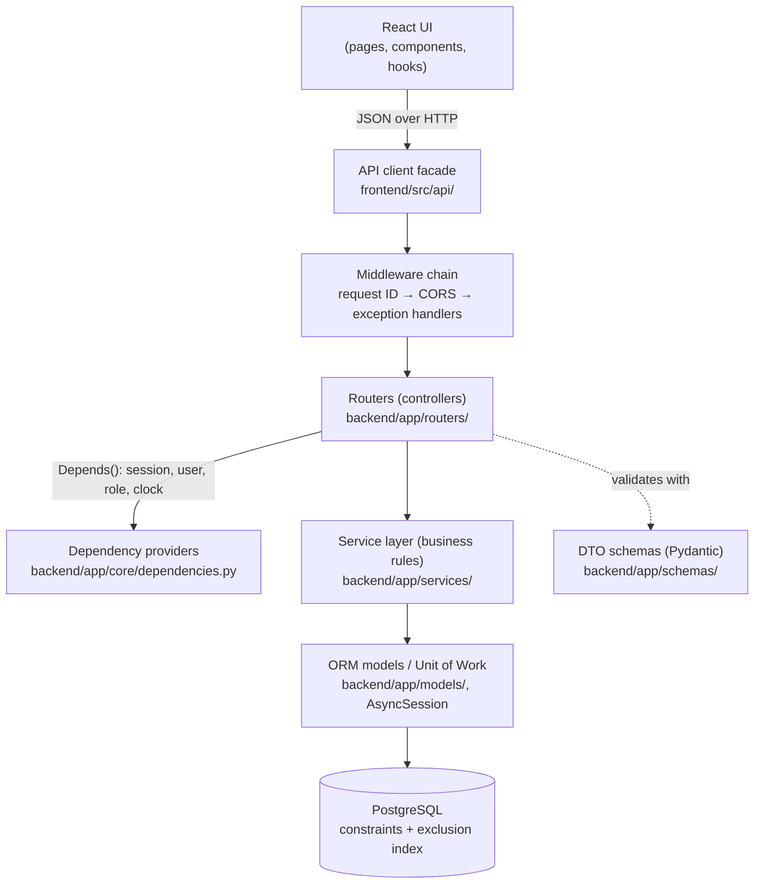
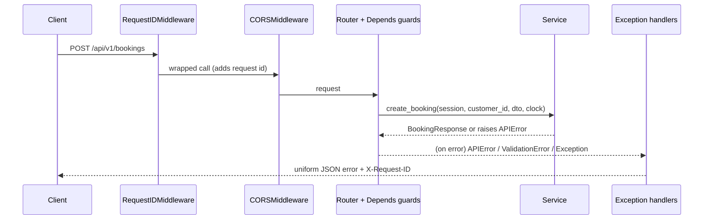
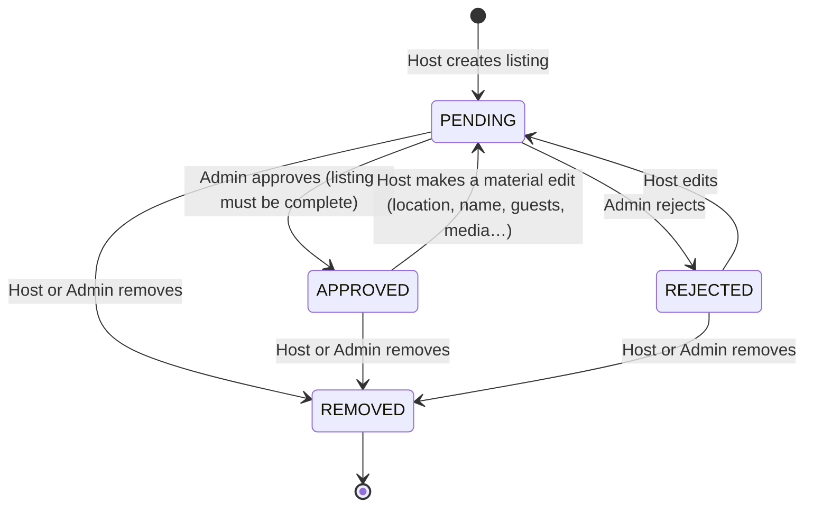
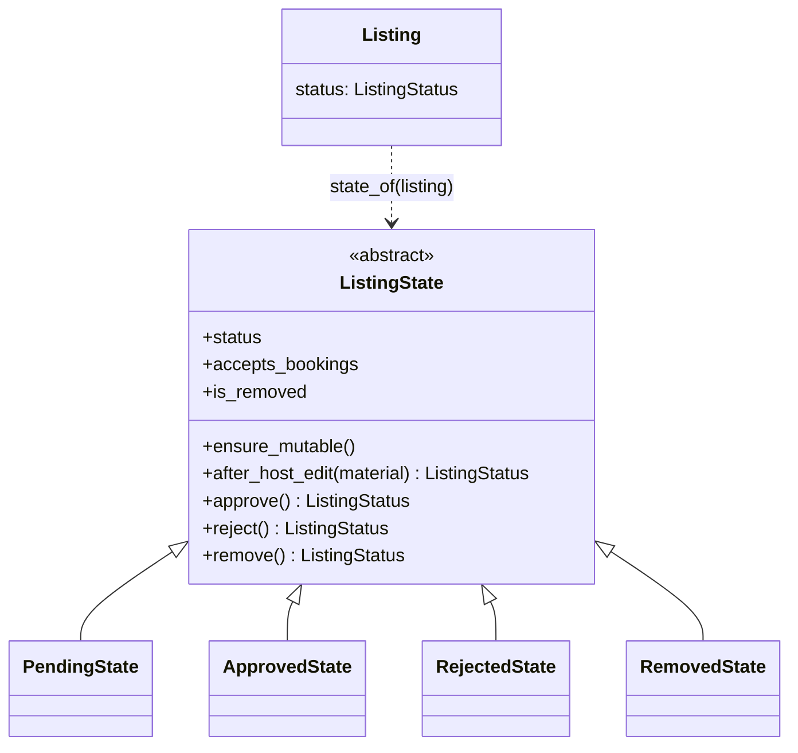
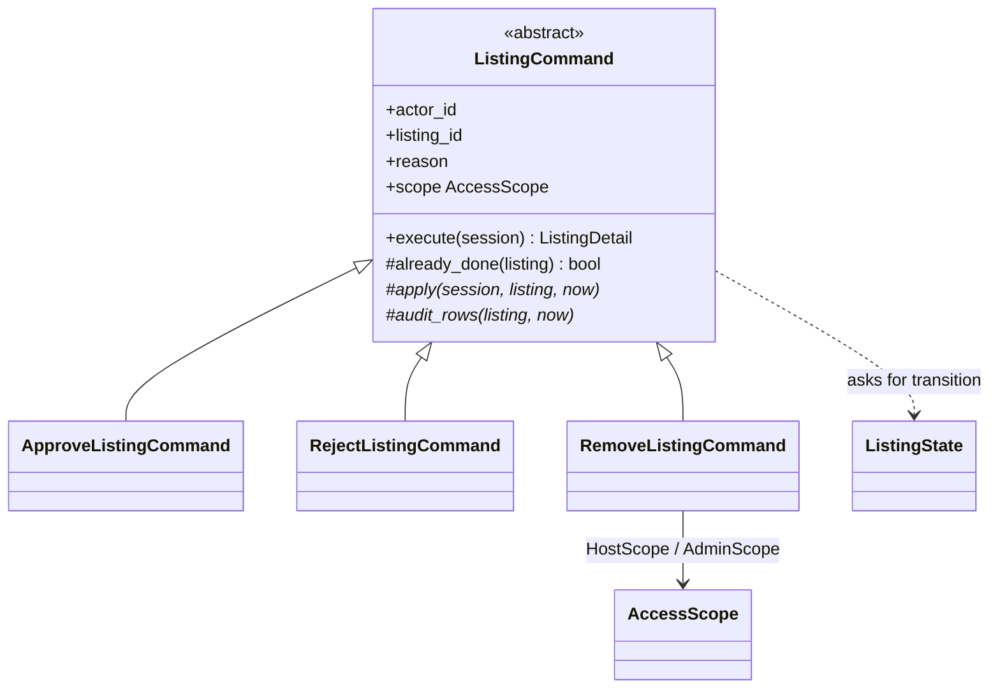
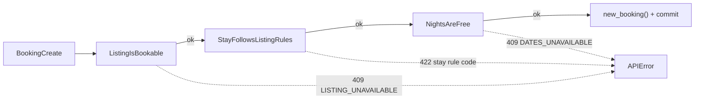

# Design patterns

This document lists the design patterns used in the Vacation Rental App. For each pattern it says where the code is, which problem it solves, and how it relates to the project requirements. It also names some code smells and the patterns we plan to use to refactor them.

Section 2 covers patterns that were in the code from the start. Section 4 covers the code smells we found and the refactorings that fixed them: 4.1–4.8 are **implemented**, and 4.9 lists what is **still proposed**. Every file reference points to working code, so the document never claims more than the code does.

---

## 1. Architecture overview

The backend is a **layered architecture**. Each layer depends only on the layer below it.

| Layer | Responsibility | Must not |
|---|---|---|
| Routers | Map HTTP to service calls, declare roles and responses | Contain business rules or SQL |
| Schemas | Validate input and shape JSON output | Touch the database |
| Services | Business rules, transactions, locking | Know about HTTP requests |
| Models | Persistence mapping and database constraints | Contain request logic |

---

## 2. Patterns implemented

### 2.1 Service Layer (layered architecture)

- **Where:** [services/](../backend/app/services/), for example [bookings.py](../backend/app/services/bookings.py), [listings.py](../backend/app/services/listings.py), [search.py](../backend/app/services/search.py) and [analytics.py](../backend/app/services/analytics.py).
- **How:** Routers stay thin. [routers/bookings.py](../backend/app/routers/bookings.py) only checks the role and calls `bookings.create_booking(...)`. Every rule (listing must be approved, nights must be free, stay length 1–14 nights, price snapshot) lives in the service.
- **Why:** The same rules apply no matter which endpoint triggers them. For example, the Host and Admin removal endpoints both call `listings.remove_listing`. Services can also be tested without HTTP.

### 2.2 Factory Method: application factory

- **Where:** [`create_app()`](../backend/app/main.py#L37) in `main.py`.
- **How:** One function builds and configures the `FastAPI` object: middleware, exception handlers, routers and the rate limiter.
- **Why:** Tests and production get identically wired applications, and no wiring happens as a side effect of importing a module.

### 2.3 Factory: database sessions

- **Where:** [`SessionFactory`](../backend/app/database/session.py#L19) (`async_sessionmaker`) and the `get_session()` generator.
- **How:** Every request gets a new `AsyncSession` from the factory, and the session is closed automatically when the request ends.
- **Why:** Callers never set up connections themselves, and connection-pool settings live in one place.

### 2.4 Singleton: configuration and engine

- **Where:** [`get_settings()`](../backend/app/core/config.py#L44), wrapped in `@lru_cache`. The module-level `engine` in [session.py](../backend/app/database/session.py).
- **How:** `Settings` is built and validated (for example, the JWT secret must be at least 32 bytes outside dev/test) once per process. Every later call returns the same instance. The engine is shared the same way.
- **Why:** There is one source of truth for configuration and one connection pool per process. The cached function remains replaceable in tests through dependency overrides, which avoids the global-state problems of a classic Singleton.

### 2.5 Dependency Injection

- **Where:** [core/dependencies.py](../backend/app/core/dependencies.py) (`SessionDep`, `CurrentUser`, `require_customer`, …) and [core/clock.py](../backend/app/core/clock.py) (`get_clock`).
- **How:** Routers declare what they need, for example `session: SessionDep, customer: Customer, clock: Clock`. FastAPI resolves and injects these values.
- **Why:** Routers are decoupled from how users are authenticated or how sessions are created. Tests replace the clock to check exact booking cut-offs, DST changes and the 30/60/90-day analytics windows.

### 2.6 Strategy: injectable clock

- **Where:** `Clock = Callable[[], datetime]`, passed to `create_booking`, `cancel_booking`, `booking_history` and `analytics`. `LoginRateLimiter` takes a `clock` argument ([throttle.py](../backend/app/core/throttle.py#L19)).
- **How:** Where the current time comes from is a pluggable function. Production uses `utc_now`, and tests use a fixed or controlled time.
- **Why:** Time-dependent rules (no cancellation after arrival, reviews only after checkout, rate-limit windows) can be tested deterministically.

### 2.7 Protection Proxy / Guard: role-based access

- **Where (backend):** [`require_roles(*roles)`](../backend/app/core/dependencies.py#L46) is a factory that returns a guard dependency. `require_customer`, `require_host` and `require_admin` are built from it. [`require_owned()`](../backend/app/core/dependencies.py#L60) checks ownership.
- **Where (frontend):** [`RequireAuth`](../frontend/src/components/Layout.jsx#L113) wraps the routes in [App.jsx](../frontend/src/App.jsx), for example `<RequireAuth roles={['HOST']}>`.
- **How:** The guard stands in front of the protected operation. It returns `401` or `403` before the operation runs. `require_owned` returns `404` for both missing resources and resources owned by someone else, so callers cannot tell whether an ID exists.
- **Why:** This implements the requirement that APIs and UI depend on the role (Customer, Host, Admin) in one reusable place, instead of repeating checks in every handler.

### 2.8 Chain of Responsibility + Decorator: middleware and error handling

- **Where:** [middleware/request_id.py](../backend/app/middleware/request_id.py), [middleware/errors.py](../backend/app/middleware/errors.py), and their registration in [main.py](../backend/app/main.py#L48-L59).
- **How:**
  - Each middleware wraps the next ASGI app (**Decorator**). `RequestIDMiddleware` also wraps `send` to add an `X-Request-ID` header to every response.
  - Exception handlers form a chain from specific to general (**Chain of Responsibility**): `APIError`/HTTP errors → `RequestValidationError` (422, or 400 for malformed JSON) → `Exception` (500 with no internal details).
- **Why:** Every error, from validation to crashes, returns the same JSON envelope (`{success:false, error:{code,message,details}, request_id}`). This meets the requirement that APIs return JSON errors and validate inputs.

### 2.9 Data Transfer Object + generic response envelope

- **Where:** [schemas/](../backend/app/schemas/). Generic envelopes [`Success[Data]`](../backend/app/schemas/common.py#L6) and [`Paginated[Item]`](../backend/app/schemas/common.py#L50).
- **How:** Pydantic models define exactly which fields come in and go out. ORM entities are never returned directly. Many inputs use `extra="forbid"`, so unknown fields are rejected.
- **Why:** The API contract stays separate from the database schema, inputs are validated before any business logic runs, and every response has the same shape (`success`, `data`, `pagination`).

### 2.10 Value Object

- **Where:** [`StayRequest`](../backend/app/services/availability.py#L23) and [`ResolvedStay`](../backend/app/services/availability.py#L36), both `@dataclass(frozen=True)`.
- **How:** These are immutable objects compared by value. `StayRequest.nights` is derived from the dates. `ResolvedStay` carries the dates, times, guests, nightly price and total cost after validation.
- **Why:** Search, quotes and booking all use the same validated stay calculation in `resolve_listing_stay`, so a quoted price can't drift from the booked price.

### 2.11 Unit of Work + pessimistic locking

- **Where:** [`create_booking`](../backend/app/services/bookings.py#L183), [`lock_listing`](../backend/app/services/listings.py#L74), and the database exclusion constraint `ex_bookings_no_confirmed_overlap` ([migration 0001](../backend/alembic/versions/0001_initial_schema_create_vacation_rental_schema.py#L276)).
- **How:** The `AsyncSession` collects all changes and commits them together or rolls them all back. Every writer first locks the listing row (`SELECT … FOR UPDATE`). The exclusion constraint is a second line of defense against double booking.
- **Why:** Two customers booking the same nights at the same time cannot both succeed. Admin moderation and Host edits can't interleave with a booking.

### 2.12 Snapshot (Memento-style)

- **Where:** `Booking` columns `nightly_price_snapshot`, `listing_name_snapshot`, `listing_address_snapshot`, `listing_zip_snapshot` and `listing_timezone_snapshot` ([models/domain.py](../backend/app/models/domain.py#L190)).
- **How:** When a booking is made, the relevant listing state is copied into the booking.
- **Why:** A booking confirmation stays correct even if the Host later changes the price or address or removes the listing. Analytics by ZIP use the ZIP at booking time.

### 2.13 Mixin (composition of shared columns)

- **Where:** [`UUIDPrimaryKey`, `CreatedAt`, `Timestamps`](../backend/app/database/base.py#L20). Used as `class Listing(UUIDPrimaryKey, Timestamps, Base)`.
- **Why:** The ID and audit-timestamp columns are defined once instead of copied into every model.

### 2.14 Facade + Adapter: frontend API client

- **Where:** [api/client.js](../frontend/src/api/client.js) and [api/endpoints.js](../frontend/src/api/endpoints.js).
- **How:**
  - **Facade:** pages call simple methods such as `bookingsApi.create(body)` or `adminApi.approve(id)`. They never handle `fetch`, headers, tokens, query strings or JSON parsing.
  - **Adapter:** `request()` converts the backend error envelope and network failures into one [`ApiError`](../frontend/src/api/client.js#L41) class that the UI can display.
- **Why:** A UI component doesn't need to know any URL, and changes to auth or headers happen in one file.

### 2.15 Adapter: map component

- **Where:** [components/MapView.jsx](../frontend/src/components/MapView.jsx) and [lib/maps.js](../frontend/src/lib/maps.js).
- **How:** The imperative Leaflet/OpenStreetMap API (`L.map`, tile layers, markers) is wrapped in a declarative React component (`<MapView markers=… onMarkerClick=… />`).
- **Why:** Pages only depend on the `MapView` props. Changing the map provider means changing only the adapter.

### 2.16 Observer: auth state and session expiry

- **Where:** [context/AuthContext.jsx](../frontend/src/context/AuthContext.jsx) and [`setUnauthorizedHandler`](../frontend/src/api/client.js#L36).
- **How:** React Context publishes `user` to all subscribing components, and they re-render when it changes. The API client lets one handler register for 401 responses, and `AuthProvider` registers `logout`. When any request finds an expired token, every subscriber updates.
- **Why:** The navbar, guarded routes and pages always agree on who is logged in, and they don't need to know about each other.

### 2.17 Adapter + Factory: object storage for media uploads

- **Where:** [app/storage/](../backend/app/storage/).
  - `ObjectStorage` ([base.py](../backend/app/storage/base.py)) is the provider-neutral interface: `create_upload`, `inspect` and `delete`.
  - `LocalDiskStorage` ([local.py](../backend/app/storage/local.py)) and `AzureBlobStorage` ([azure_blob.py](../backend/app/storage/azure_blob.py)) are the **adapters**.
  - `build_storage()` with the `PROVIDERS` registry ([\_\_init\_\_.py](../backend/app/storage/__init__.py)) is the **factory**. It picks the adapter from `STORAGE_PROVIDER`.
- **How:** [services/media.py](../backend/app/services/media.py) and the routers only see `ObjectStorage`, which is injected with `StorageDep`. The browser uploads with whatever URL, method and headers the ticket returns, so it doesn't know which provider is in use.
- **Why:** moving between local disk, Azure Blob, S3 or GCS is a configuration change plus at most one new adapter class. Tests inject a temporary-folder adapter. See [media-storage.md](media-storage.md).

---

## 3. Pattern → requirement map

| Requirement (project statement) | Patterns supporting it |
|---|---|
| JSON APIs with validation and error handling | DTO + envelope (2.9), Chain of Responsibility (2.8) |
| Role-based APIs and UI (Customer / Host / Admin) | Protection Proxy (2.7), Dependency Injection (2.5), Observer (2.16) |
| Search by date, time, guests, duration (max 14 days) | Value Object (2.10), Service Layer (2.1), Specification (4.6) |
| Book / cancel a stay | Unit of Work + locking (2.11), Snapshot (2.12), Strategy clock (2.6), Chain of Responsibility (4.3) |
| Reviews on past bookings | Strategy clock (2.6), Service Layer (2.1) |
| Host listing management, Admin approve/remove | Service Layer (2.1), State (4.1), Command (4.2), Strategy scopes (4.4) |
| Analytics for 30/60/90 days by ZIP | Strategy clock (2.6), Snapshot ZIP (2.12), Strategy scopes (4.4), Value Object (4.7) |
| Maps / address search | Adapter (2.15) |
| Host photos and videos | Adapter + Factory (2.17), Dependency Injection (2.5) |
| Web UI calling deployed APIs | Facade + Adapter (2.14) |

---

## 4. Code smells and pattern refactorings

| # | Pattern | Smell it fixed | Status |
|---|---|---|---|
| 4.1 | State | Status `if` checks spread across functions (*Switch Statements*, *Shotgun Surgery*) | ✅ Implemented |
| 4.2 | Command | Moderation actions as ad-hoc functions | ✅ Implemented |
| 4.3 | Chain of Responsibility + Factory Method | ~75-line `create_booking` (*Long Method*) | ✅ Implemented |
| 4.4 | Strategy (access scope) | `host_id=None` arguments (*Flag Argument*) | ✅ Implemented |
| 4.5 | Template Method | Pagination repeated in five functions (*Duplicate Code*) | ✅ Implemented |
| 4.6 | Specification | Long filter `if` chain in `search()` | ✅ Implemented |
| 4.7 | Value Object | Analytics metrics as raw dicts (*Primitive Obsession*) | ✅ Implemented |
| 4.8 | Extract Module | `services/listings.py` mixing editing and moderation (*Large Class*, *Divergent Change*) | ✅ Implemented |
| 4.9 | Repository, Observer, Factory, pricing Strategy, Builder | See 4.9 | Proposed |

All refactors kept the public API unchanged (same endpoints, JSON and error codes). All 428 backend tests pass. The only test change was one test that called the removed `listings.remove_listing` directly; it now runs `RemoveListingCommand`.

### 4.1 State: listing lifecycle

- **Where:** [services/listing_state.py](../backend/app/services/listing_state.py): `ListingState` ([L32](../backend/app/services/listing_state.py#L32)), `PendingState`, `ApprovedState`, `RejectedState`, `RemovedState`, and `state_of(listing)` ([L99](../backend/app/services/listing_state.py#L99)).
- **Before:** `if listing.status == …` checks in `ensure_mutable`, `host_edit`, `moderate`, `remove_listing` and `create_booking`.
- **After:** each state object owns its allowed transitions (`approve`, `reject`, `remove`, `after_host_edit`) and its rules (`ensure_mutable`, `accepts_bookings`). Callers ask the state:
  - [`ensure_mutable`](../backend/app/services/listings.py#L78) and [`host_edit`](../backend/app/services/listings.py#L82) in `listings.py`
  - The moderation commands (4.2)
  - The booking check [`ListingIsBookable`](../backend/app/services/bookings.py#L101)
- **Benefit:** adding a status such as `SUSPENDED` means adding one class, not editing five functions.

### 4.2 Command: moderation and removal

- **Where:** [services/moderation.py](../backend/app/services/moderation.py): `ListingCommand` ([L27](../backend/app/services/moderation.py#L27)), `ApproveListingCommand`, `RejectListingCommand`, `RemoveListingCommand`.
- **Before:** `moderate()` and `remove_listing()` in `listings.py` each locked the listing, checked the status, changed it and wrote audit rows inline.
- **After:** each action is an object built from the actor, the listing and the reason. The base class's `execute(session)` runs the shared steps: lock the listing, skip if already done, `apply()`, `audit_rows()`, then commit. The `AdminAction` table is now a log of executed commands. Routers create and run commands: [routers/admin.py](../backend/app/routers/admin.py) and [routers/host.py](../backend/app/routers/host.py).
- `execute` is also a small Template Method: the subclasses only supply `apply` and `audit_rows`.

### 4.3 Chain of Responsibility: booking checks

- **Where:** [services/bookings.py](../backend/app/services/bookings.py): `BookingContext` ([L70](../backend/app/services/bookings.py#L70)), `BookingCheck` ([L83](../backend/app/services/bookings.py#L83)), and `booking_checks()` ([L142](../backend/app/services/bookings.py#L142)), which builds the chain.
- **Chain:** `ListingIsBookable` (locks the listing; the State must accept bookings) → `StayFollowsListingRules` (dates, local times, guests, 1–14 nights, DST; 422 on failure) → `NightsAreFree` (409 `DATES_UNAVAILABLE`).
- **Factory Method:** [`new_booking()`](../backend/app/services/bookings.py#L148) builds the `Booking` with its listing snapshots.
- **After:** [`create_booking`](../backend/app/services/bookings.py#L183) is now about 25 lines: run the chain, build the booking, commit. A new rule (for example "minimum 2 nights on weekends") is one new handler.

### 4.4 Strategy: access scope (replaces flag arguments)

- **Where:** [services/scopes.py](../backend/app/services/scopes.py): `AccessScope` ([L15](../backend/app/services/scopes.py#L15)), `HostScope(host_id)`, `AdminScope()`.
- **Before:** `analytics(..., host_id=None)`, `remove_listing(..., host_id=None)` and `listing_page(..., host_id=None)` each worked out who the caller was by checking whether `host_id` was passed.
- **After:** callers pass a scope object, and it supplies:
  - `listing_filters()`, the SQL conditions
  - `owner_id`, which the listing lock must match
  - `records_admin_action`, whether a removal is audited
  - `label`, `HOST` or `ADMIN` in the analytics response

  These are used in [analytics.py](../backend/app/services/analytics.py#L43), `ListingPage` in `listings.py`, and `RemoveListingCommand`.

### 4.5 Template Method: pagination

- **Where:** [services/pagination.py](../backend/app/services/pagination.py): `PageQuery.fetch()` ([L28](../backend/app/services/pagination.py#L28)) fixes the steps: count, guard the offset, load one ordered page, map the rows, build `Paginated`.
- **Subclasses** supply only `statement()`, `order_by()` and `to_item()`/`to_items()`: `ListingPage` and `BlockPage` (listings.py), `AuditPage` (moderation.py), `BookingHistoryPage` (bookings.py), `ReviewPage` (reviews.py).
- **Side benefit:** the large-offset guard that only two endpoints had now applies to all five.

### 4.6 Specification: search filters

- **Where:** [services/search_filters.py](../backend/app/services/search_filters.py): `SearchSpecification` ([L17](../backend/app/services/search_filters.py#L17)), `CityIs`, `StateIs`, `ZipCodeIs`, `FitsGuests`, `PriceAtLeast`, `PriceAtMost` and `HasAllAmenities`, registered in `SPECIFICATIONS`.
- **After:** [`search()`](../backend/app/services/search.py#L149) builds its filters in one line, `[Listing.status == APPROVED, *search_filters(query)]`. A new filter is one new class, without editing `search()` (Open/Closed Principle).

### 4.7 Value Object: analytics metrics

- **Where:** [`BookingMetrics`](../backend/app/services/analytics.py#L25), a dataclass with `add(row)` and `as_dict()`.
- **Before:** `empty_metrics()` and `accumulate()` passed dicts keyed by strings. **After:** totals, per-ZIP and per-day groups are all `BookingMetrics`.

### 4.8 Extract Module: splitting `listings.py`

- Moderation, removal and the audit log moved to [moderation.py](../backend/app/services/moderation.py), and pagination to [pagination.py](../backend/app/services/pagination.py). `listings.py` now holds only Host listing editing, 481 lines down from 555, with a single reason to change.

### 4.9 Still proposed

- **Repository:** services still build SQLAlchemy queries inline. Introducing `ListingRepository` and `BookingRepository` would let services be unit-tested with in-memory fakes.
- **Observer (domain events):** publish `BookingCreated`, `BookingCancelled`, `ListingApproved` and `ListingRemoved`, with subscribers for audit, email notifications and analytics. The commands in 4.2 are the natural places to publish them.
- **State for bookings:** `ReservationState` (CONFIRMED → CANCELLED) could follow 4.1.
- **Factory, for user registration:** `register_user(session, request, role)` → `UserFactory.create(role, data)`.
- **Strategy, for pricing:** [`cost_rating`](../backend/app/services/listings.py#L88) has hard-coded thresholds, and the total is always nightly price × nights. A `PricingStrategy` would allow weekend surcharges or discounts for long stays.
- **Strategy, for search sorting:** the `if query.sort == …` chain in `search()`.
- **Builder, for test and seed data:** for example `ListingBuilder().with_hours().approved().build()`.

---

## 5. Keeping this document current

- When a PR adds or refactors a pattern, update the matching section and its file links in the same PR.
- When a proposed refactoring from section 4 is implemented, move it into section 2 and link the PR.
