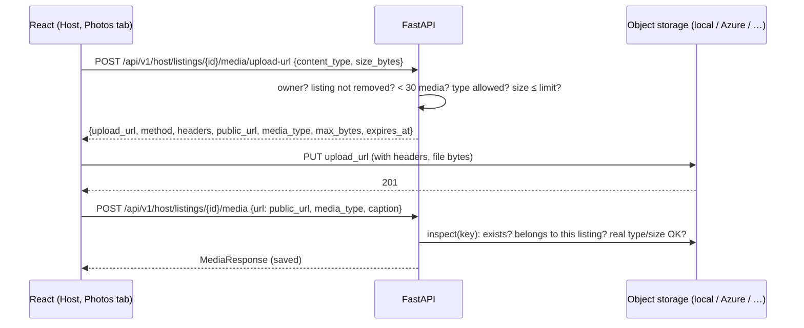

# Media storage (Host photo and video uploads)

Hosts upload photos and videos directly from the browser to object storage using a **short-lived presigned upload URL**. The API only issues the URL, then checks the stored file before saving it. File bytes never pass through the API servers. The one exception is the local development provider described below, which plays the cloud's role on your own machine.

The storage provider is a configuration setting. It defaults to `local`, which needs no cloud account, so the whole flow works on a laptop today.

## Upload flow



- Nothing is saved to the database until the final `POST /media`. An upload that is never saved leaves an orphaned file; see the cleanup section.
- Pasting an external HTTPS URL still works, and the seed data uses that.
- Deleting a media item, or replacing its URL, deletes the stored file as long as no other media row still references it.

## API

| Endpoint | Purpose |
|---|---|
| `POST /api/v1/host/listings/{id}/media/upload-url` | Host only. Body `{"content_type": "image/jpeg", "size_bytes": 482133}`. Returns the upload ticket. |
| `PUT <upload_url>` | Sends the file. Use the returned `method` and `headers`. For `local`, this is `PUT /api/v1/uploads/{token}` on the API. |
| `POST /api/v1/host/listings/{id}/media` | Existing endpoint. Pass `url = public_url` after the upload succeeds. |

**Allowed types:** `image/jpeg`, `image/png`, `image/webp` (IMAGE) and `video/mp4`, `video/webm` (VIDEO).

**Limits:** 10 MB per image and 200 MB per video (configurable). The upload URL also caps the upload at the declared `size_bytes` where the provider can enforce it.

**Error codes:**

| Code | Meaning |
|---|---|
| `FILE_TOO_LARGE` | 422 or 413: the file is over the limit |
| `INVALID_MEDIA_UPLOAD` | 422: file missing, wrong type, or belongs to another listing |
| `UPLOAD_URL_INVALID` | 403: upload URL expired or forged |
| `UNSUPPORTED_MEDIA_TYPE` | 415: the `Content-Type` sent doesn't match the ticket |
| `EMPTY_UPLOAD` | 422: the uploaded file has no content |

## Configuration (`backend/.env`)

| Setting | Default | Meaning |
|---|---|---|
| `STORAGE_PROVIDER` | `local` | `local` or `azure`. Add more providers as shown below. |
| `API_PUBLIC_BASE_URL` | `http://127.0.0.1:8000` | Externally reachable API URL. Local upload URLs are built from it. |
| `STORAGE_PUBLIC_BASE_URL` | *(derived)* | Where stored files are publicly read: a CDN or custom domain. Defaults to `<API>/media` for local and the blob container URL for Azure. |
| `STORAGE_LOCAL_ROOT` | `media-uploads` | Folder for local files, relative to `backend/`. Ignored by Git. |
| `UPLOAD_URL_TTL_SECONDS` | `600` | How long an upload URL stays valid. |
| `MEDIA_MAX_IMAGE_BYTES` / `MEDIA_MAX_VIDEO_BYTES` | 10 MB / 200 MB | Size limits. |
| `AZURE_STORAGE_ACCOUNT_NAME`, `AZURE_STORAGE_ACCOUNT_KEY`, `AZURE_STORAGE_CONTAINER` | empty / empty / `listing-media` | Azure placeholders. |

## Providers

### `local` (default: development, tests, demos)

[`app/storage/local.py`](../backend/app/storage/local.py) imitates a cloud bucket:

- **Upload URL:** the API returns `PUT /api/v1/uploads/{token}`, where the token is a signed, expiring JWT. It allows exactly one object key, one content type and a maximum size, and it can't be used as a login token.
- **Storage:** files are written to `backend/media-uploads/` and served read-only at `<API>/media/…`.
- **HTTP URLs:** these URLs are plain HTTP on loopback (`127.0.0.1` or `localhost`). The API accepts them only when `APP_ENV` is `development` or `test`, and the database constraint allows only loopback `/media/` addresses besides HTTPS (migration 0003).
- **Not for production behind a load balancer:** each VM would have its own disk, so a file uploaded to one VM wouldn't exist on the others.

### `azure` (placeholder: ready to switch on, not yet run against a real account)

[`app/storage/azure_blob.py`](../backend/app/storage/azure_blob.py) issues a **SAS** with create and write permission for one blob, and checks uploads with `get_blob_properties`. SAS generation was checked offline. Uploading, inspecting and deleting have not been run against a real account yet.

To switch it on:

1. **Install the SDK:** `pip install -e 'backend[azure]'`, which installs `azure-storage-blob` and `aiohttp`.
2. **Create the storage:** a Storage Account and a container named `listing-media`. Allow anonymous **blob** read access on the container, because listing photos are public. Alternatively, put Azure CDN or Front Door in front and set `STORAGE_PUBLIC_BASE_URL`.
3. **Add a CORS rule on the storage account (Blob service):** this step is required, because without it the browser upload fails.
   - Allowed origins: your UI origin(s)
   - Methods: `PUT, GET, HEAD`
   - Allowed headers: `content-type, x-ms-blob-type`
   - Exposed headers: `*`
   - Max age: `3600`
4. **Set the environment:** `STORAGE_PROVIDER=azure`, `AZURE_STORAGE_ACCOUNT_NAME`, `AZURE_STORAGE_ACCOUNT_KEY` and `AZURE_STORAGE_CONTAINER`.
5. **Production hardening:** use a managed identity on the scale set with a *user delegation SAS* instead of the account key. Only `AzureBlobStorage._sas` and `_client` need to change.

No other code, frontend or database change is needed: the UI simply sends the file wherever the ticket says.

### Adding another provider (example: AWS S3, Google Cloud Storage, MinIO)

1. **Write an adapter** that subclasses `ObjectStorage` (in [`app/storage/base.py`](../backend/app/storage/base.py)) and implements three methods:

   ```python
   class S3Storage(ObjectStorage):
       def create_upload(self, key, content_type, max_bytes, expires_at) -> UploadTicket:
           url = s3.generate_presigned_url(
               "put_object",
               Params={"Bucket": bucket, "Key": key, "ContentType": content_type},
               ExpiresIn=int((expires_at - datetime.now(UTC)).total_seconds()),
           )
           return UploadTicket(upload_url=url, public_url=self.public_url(key),
                               expires_at=expires_at, max_bytes=max_bytes,
                               headers={"Content-Type": content_type})

       async def inspect(self, key) -> StoredObject | None: ...  # head_object → size, ContentType
       async def delete(self, key) -> None: ...                 # delete_object
   ```

2. **Register it:** add a builder to `PROVIDERS` in [`app/storage/__init__.py`](../backend/app/storage/__init__.py), add the name to `Settings.storage_provider`, and add its settings to `.env.example`.
3. **Configure the bucket:** enable bucket CORS for `PUT` from the UI origin, and allow public or CDN read access for the media prefix.

## Design patterns used

| Pattern | Where |
|---|---|
| **Adapter** | `ObjectStorage` is the interface the app uses. `LocalDiskStorage` and `AzureBlobStorage` adapt each provider's API to it. |
| **Factory** | `build_storage()` / `PROVIDERS` choose the adapter from `STORAGE_PROVIDER`, in one place. |
| **Dependency Injection** | Routers receive `StorageDep`. Tests replace it with a temporary-folder `LocalDiskStorage`. |

## Security notes

- **Key naming:** object keys are generated by the server (`listings/{listing_id}/{random}.{ext}`). Client file names are never used.
- **Final checks:** before saving, the API checks that the object exists, sits under this listing's prefix, and has an allowed real type and size. Oversized objects are deleted.
- **Ownership first:** the ownership check runs before any storage lookup, so another Host only ever sees `404`.
- **Lock discipline:** storage lookups happen *before* the listing row lock, so no network call runs while the lock is held.
- **Reusable URL:** an upload URL can be reused until it expires (10 minutes), which is the same behavior as cloud presigned URLs. It can only overwrite its own random key.

## Known gaps and next steps

- **Orphan cleanup:** files that are uploaded but never saved need cleaning up. Add a storage lifecycle rule (for example, delete `listings/` objects older than 1 day with no database row), or a periodic job that compares stored keys with `listing_media.url`.
- **Image processing:** there is no thumbnail generation or video transcoding. If needed, add a storage-event worker that does it.
- **Removed listings:** soft-removing a listing keeps its media files, consistent with keeping removal history.
